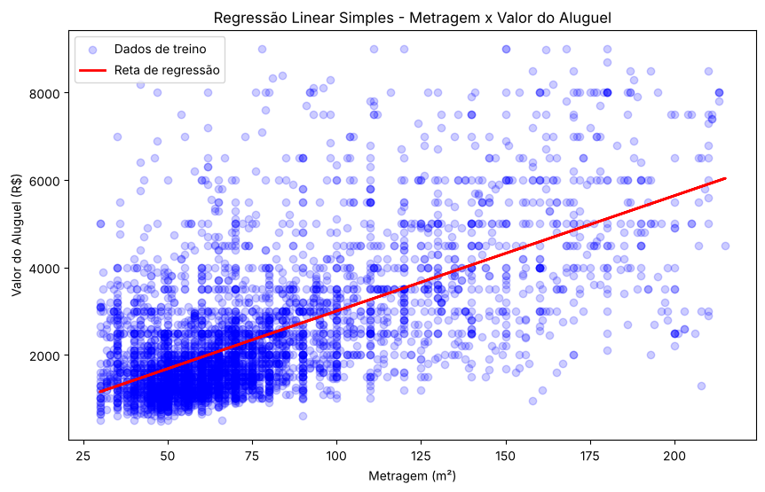

# Previsão do valor de aluguel com regressão linear

Modelos de regressão linear simples e múltipla que estimam o valor do aluguel de um imóvel a partir das suas características: metragem, valor do condomínio e número de quartos, banheiros, suítes e vagas.

Projeto desenvolvido como exercício prático do módulo 18 (Regressão Linear) do curso Profissão Cientista de Dados. O trabalho segue as etapas do CRISP-DM: entendimento e preparação dos dados, modelagem e avaliação.

## Contexto

Quem procura um apartamento para alugar normalmente sabe o tamanho do imóvel, o valor do condomínio e quantos quartos, banheiros e vagas ele tem. A ideia é usar essas informações para estimar o aluguel esperado e saber se o imóvel cabe no orçamento antes mesmo de visitá-lo.

## Base de dados

`ALUGUEL_MOD12.csv`: 7.203 imóveis e 7 variáveis numéricas.

| Variável | Descrição |
|---|---|
| Valor_Aluguel | Valor do aluguel (variável alvo) |
| Valor_Condominio | Valor do condomínio |
| Metragem | Área do imóvel em m² |
| N_Quartos | Número de quartos |
| N_banheiros | Número de banheiros |
| N_Suites | Número de suítes |
| N_Vagas | Número de vagas de garagem |

## Etapas

1. **Diagnóstico:** verificação dos tipos de dados e dos valores faltantes (a base não tem nulos).
2. **Limpeza:** remoção de 598 linhas duplicadas e de 30 registros incoerentes, com mais suítes do que banheiros.
3. **Outliers:** IQR com limite de 3× (outliers extremos) no aluguel e na metragem, o que removeu 7% das linhas. O limite tradicional de 1,5× descartaria cerca de 16% da base, incluindo imóveis de alto padrão que existem de verdade.
4. **Análise exploratória:** gráficos bivariados e matriz de correlação. A metragem é a variável mais correlacionada com o aluguel (0,65).
5. **Modelagem:** divisão de 80% para treino e 20% para teste, regressão linear simples (só a metragem) e regressão linear múltipla (todas as variáveis).
6. **Avaliação:** comparação do R² de treino e de teste para identificar overfitting ou underfitting.

## Resultados

| Modelo | R² treino | R² teste | MAE teste | RMSE teste |
|---|---|---|---|---|
| Regressão linear simples (Metragem) | 0,414 | 0,435 | R$ 812 | R$ 1.145 |
| Regressão linear múltipla (6 variáveis) | 0,519 | 0,508 | R$ 752 | R$ 1.069 |
| Regressão linear múltipla sem N_Suites (modelo final) | 0,518 | 0,506 | R$ 752 | R$ 1.070 |

- Equação do modelo simples: **Valor_Aluguel = 26,41 × Metragem + 359,39**. Cada m² a mais soma cerca de R$ 26 ao aluguel.
- A regressão múltipla teve o melhor desempenho, e nenhum dos modelos mostra overfitting, porque o R² de treino e o de teste ficaram próximos.
- O modelo final erra em média cerca de R$ 750 por imóvel (MAE). Isso basta como referência de preço, mas ainda é um erro grande perto do aluguel médio de cerca de R$ 2.370.



## Melhorias aplicadas

- **Erro em reais:** além do R², os modelos são avaliados com MAE, MSE e RMSE, que mostram o tamanho do erro na mesma unidade do aluguel.
- **Análise dos resíduos:** a média dos resíduos é praticamente zero, mas eles formam um funil (o erro cresce nos imóveis mais caros) e têm uma cauda à direita, com imóveis bem mais caros do que o modelo prevê.
- **Multicolinearidade:** banheiros e suítes têm correlação de 0,92 e VIF acima de 6. Sem `N_Suites`, todos os VIFs ficam abaixo de 4 e o desempenho praticamente não muda, por isso esse virou o modelo final.
- **Padronização:** com as variáveis padronizadas, os coeficientes podem ser comparados. A metragem é a variável mais importante, seguida do número de quartos (efeito negativo para o mesmo tamanho) e do condomínio.
- **Localização:** a base não tem bairro nem região. Com essa informação, o próximo passo seria codificá-la com One-Hot Encoding, já que a localização costuma ser o fator que mais pesa no preço.

## Como executar

```bash
pip install -r requirements.txt
jupyter notebook
```

Abra o notebook `previsao_aluguel_regressao_linear.ipynb` com o arquivo `ALUGUEL_MOD12.csv` na mesma pasta. O notebook também roda no Google Colab: basta enviar o CSV para a sessão antes de executar.

## Tecnologias

Python, pandas, matplotlib, seaborn e scikit-learn.
